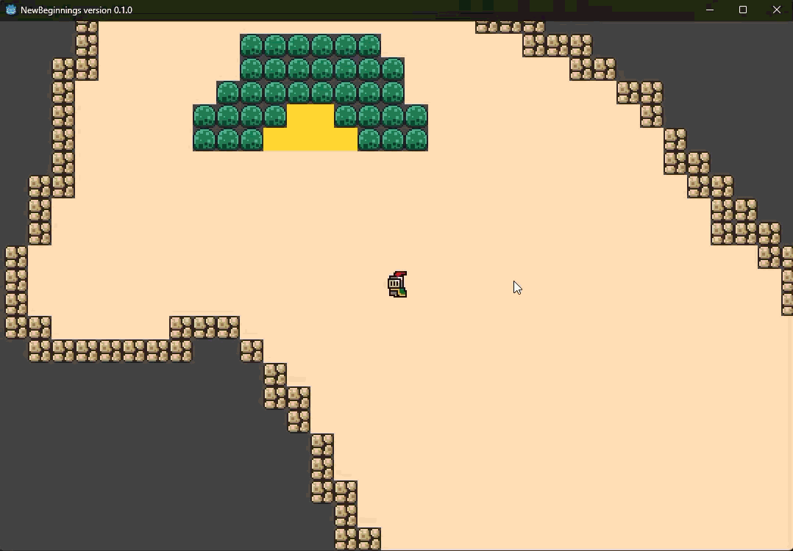

# New Beginnings

| Exploration | Loot drop |
| :---: | :---: |
|  |  |
| **Boss fight** | **Character sheet** |
|  |  |

**A turn-based fantasy RPG built in Godot 4: explore four regions, fight through random encounters, and chase randomized loot up to legendary rarity.**


---

## Features

- **Turn-based combat** with speed-based initiative. Faster fighters attack several times per turn, and each attack rolls hit, evasion and armor.
- **Five combat actions:** Attack, Heal, Sweep (hits every enemy), All-in (spend HP for a heavy hit) and Run.
- **Randomized loot:** 17 equipment types across 11 slots, with five rarity tiers from Common (65%) to Legendary (0.2%). Each item rolls its own stats.
- **11 monsters** spread over four regions (Plains, Woods, Mountains and the Ruins), ending in a fight against the **Demon Slime** boss.
- **Character progression:** gain EXP, level up, and choose +HP, +Strength or +Speed each level.
- **Real stakes:** dying destroys a random piece of your equipped gear.
- **Two NPCs and a side quest** that rewards a guaranteed rare weapon.
- **Inventory and equipment UI** with drag and drop, slot highlighting and a live stat sheet.

## Download & Play

> **Windows only.** No installation needed.

1. Download **`NewBeginnings_version_0.1.2.exe`** from the **[latest release](https://github.com/JosiahKey/New_Beginnings/releases/latest)**.
2. Double-click it to play.
3. Windows SmartScreen may warn about an unrecognized app because the build isn't code-signed. Click **More info → Run anyway**.

Your inventory is saved automatically to `%APPDATA%\Godot\app_userdata\`.

### Run from source

1. Install [Godot 4.6](https://godotengine.org/download) (standard build, not .NET).
2. Clone this repo and open `project.godot` in Godot.
3. Press **F5** to run.

## Controls

| Input | Action |
| --- | --- |
| <kbd>W</kbd> <kbd>A</kbd> <kbd>S</kbd> <kbd>D</kbd> | Move |
| <kbd>E</kbd> | Interact (open chests, talk to NPCs) |
| <kbd>Tab</kbd> | Open inventory |
| Left mouse | Choose combat actions and targets, drag and drop items, navigate menus |
| <kbd>T</kbd> | Show/hide the controls hint |

## Technical Highlights

The full architecture write-up, with diagrams, is in **[docs/DESIGN.md](docs/DESIGN.md)**.

- **Event-driven architecture.** Systems talk through one global `SignalBus` autoload instead of holding references to each other. A chest, an NPC and a combat victory all produce loot by emitting the same signal, and none of them know the item generator exists. Level and combat scenes can be created and freed without breaking anything.
- **Signal-driven turn queue.** Combat turn order is a queue of `Callable`s sorted by speed. Each combatant's `turn_start` arms the next step and its `turn_finished` fires it, so turns chain themselves without a central game loop or per-frame polling.
- **Procedural item generation pipeline.** Items go through a five-stage pipeline: base type → weighted rarity roll → per-category stat rolls → rarity-based stat budget → unique id. Callers can pin any of type, slot or rarity, which is how the quest guarantees a rare weapon.
- **Data-driven content.** Items, enemies and per-biome spawn tables are JSON files loaded at startup. Balancing the game means editing data, not code.
- **Stateless stat recalculation.** Equipping an item rebuilds the player's derived stats from scratch, which rules out bugs where removing gear leaves a bonus behind.
- **Persistent root scene.** One `Main` scene owns the UI and systems. A `LevelManager` swaps exactly one level beneath it, and combat runs as an overlay so the world state underneath is kept.

## Project Structure

```
Globals/   Autoload singletons (SignalBus, GameState, GameData, PlayerData, CombatData, AudioManager, Tooltip)
Scripts/   Gameplay logic (combat engine, item generator, level manager, player, enemies, NPCs, UI)
Scenes/    Levels, biomes, reusable templates, UI and combat scenes
Data/      JSON content: items, enemies, biome spawn tables, starting inventory
docs/      Design document and media
```

## Credits

- Enemy sprites: rvros
- Knight and slime sprites: Brackeys
- Music: Braxton
- Font: [Jeti on DaFont](https://www.dafont.com/jeti.d1589)
- README and design document written with help from [Claude](https://claude.ai) by Anthropic

## License

Copyright © 2025–2026 Josiah Key. All rights reserved. The source is public for viewing and evaluation; see [LICENSE](LICENSE). Third-party assets belong to their creators listed above.
