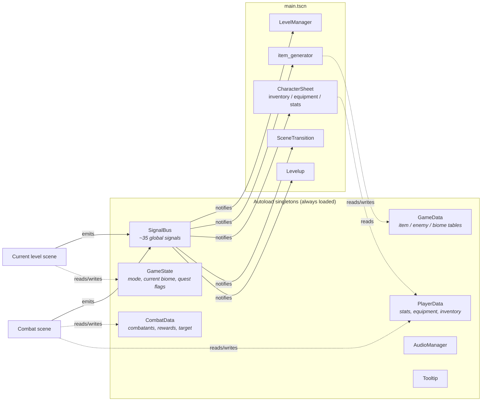
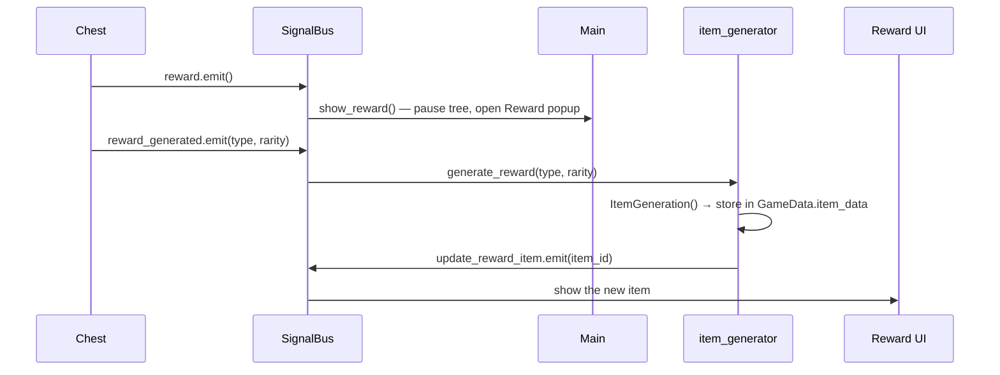
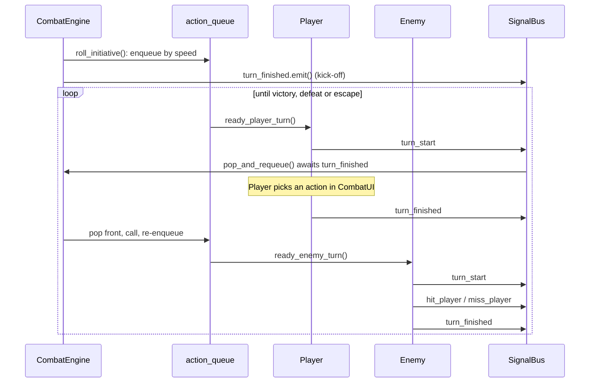
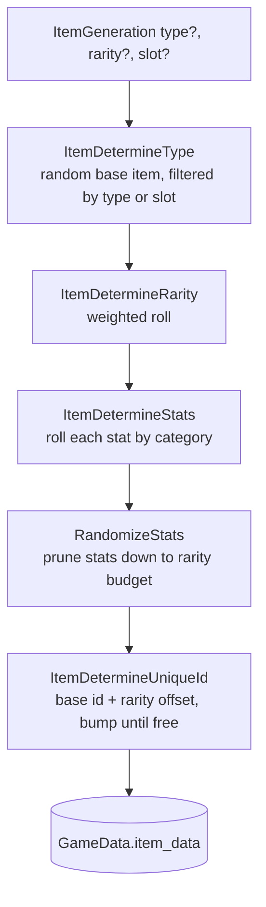
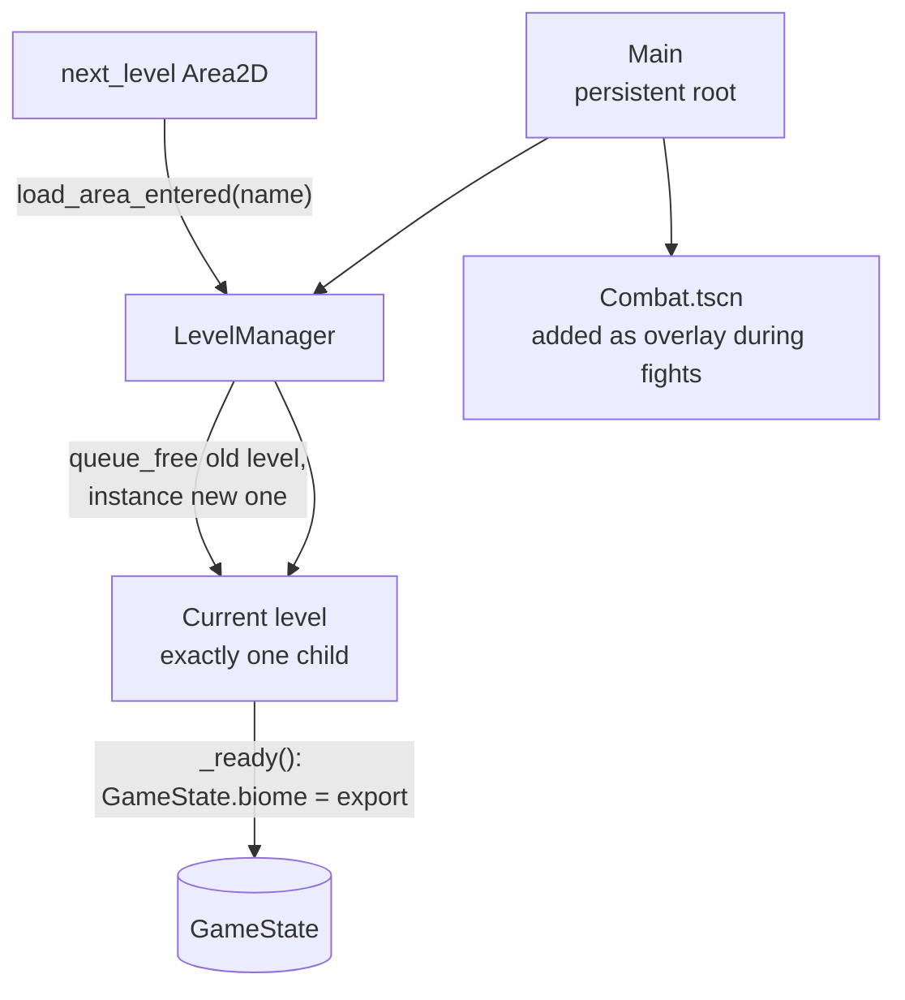
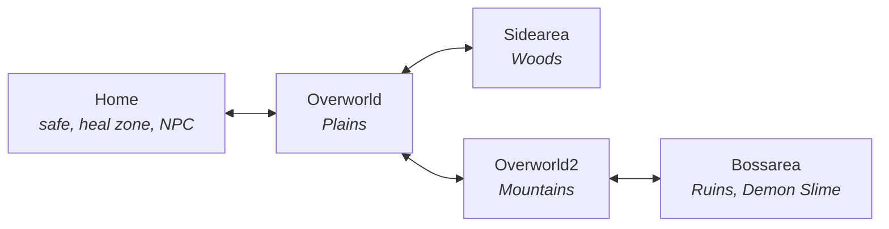

# New Beginnings: Design & Architecture

This document explains how the game is put together: how the global singletons and the signal bus keep systems decoupled, how a combat encounter runs, how loot is rolled, and how the player moves between levels. Everything here describes the code as it currently exists in this repository.

- [Project layout](#project-layout)
- [Architecture overview](#architecture-overview)
- [The signal bus](#the-signal-bus)
- [Data-driven content](#data-driven-content)
- [Combat engine](#combat-engine)
- [Item generator](#item-generator)
- [Scene and level flow](#scene-and-level-flow)
- [Persistence](#persistence)
- [Known limitations and next steps](#known-limitations-and-next-steps)

---

## Project layout

| Path | Contents |
| --- | --- |
| `Globals/` | Autoload singletons: `SignalBus`, `GameState`, `GameData`, `PlayerData`, `CombatData`, `AudioManager`, `Tooltip` |
| `Scripts/` | Gameplay scripts: `combat_engine`, `combat_player`, `combat_ui`, `enemy`, `item_generator`, `level_manager`, `player`, `npc`, `chest`, … |
| `Scripts/UI/` | Inventory, equipment, stat panel, reward and level-up screens |
| `Scenes/Levels/` | Hand-built overworld areas (Home, Overworld, Sidearea, Overworld2, Bossarea) |
| `Scenes/Templates/` | Reusable pieces: player, enemy, chest, NPCs, level exits, heal zone |
| `Data/` | JSON content tables: items, enemies, biome spawn tables, starting inventory |

---

## Architecture overview

The game uses Godot's autoload singletons for shared state and a single global event hub, `SignalBus`, for communication. Scenes rarely hold references to each other. A chest doesn't know an inventory exists; it just announces "a reward was generated", and whatever cares about that reacts.

**Singleton responsibilities**

| Singleton | Role |
| --- | --- |
| `SignalBus` | Declares every cross-system signal in one file. Each signal is commented with its sender and receiver, so the file doubles as a map of the game's event flow. |
| `GameState` | Small global flags: `state` (`"Combat"` while a fight is active, which freezes overworld movement), the current `biome`, and quest progress. |
| `GameData` | Loads the JSON content tables at startup and holds every generated item in `item_data`. Also owns the rarity distribution and the stat category lists the item generator uses. |
| `PlayerData` | Base stats, equipped items per slot, and inventory. Exposes derived values (`get_min_damage()`, `get_total_speed()`, …) so callers don't recompute formulas. |
| `CombatData` | Per-fight state: a dictionary of combatants keyed by id (`"player"`, `"enemy1"`, …), the selected target, enemies remaining, and accumulated EXP and loot. Cleared when combat ends. |
| `AudioManager` | Music switching between exploration, combat and boss tracks. |
| `Tooltip` | Shared tooltip node for item and enemy info. |

---

## The signal bus

All signals live in `Globals/signal_bus.gd`. Systems connect in `_ready()` and emit with `SignalBus.<signal>.emit(...)`. This gives:

- **Loose coupling:** a chest, an NPC and a combat victory all produce loot the same way, by emitting `reward_generated`. None of them reference the item generator.
- **Simple scene swapping:** levels and the combat scene can be created and freed freely because nothing holds a direct reference to them.
- **One place to read the event flow:** the comment above each signal names its sender and receiver.

Example: opening a chest.

---

## Data-driven content

Content is defined in JSON under `Data/` and loaded by `GameData._ready()`, so balance changes don't need code changes.

| File | Defines |
| --- | --- |
| `items_data.json` | 17 base equipment types (6 weapons, 8 armor pieces, 3 jewelry). Each has base stats, an equipment slot, a type, and a damage multiplier per rarity (`commonMulti` 1.0 up to `legendaryMulti` 3.0). |
| `enemy_data.json` | 11 enemies (10 regular plus the Demon Slime boss) with HP, damage range, accuracy, evasion, armor (`PDR`), speed, EXP and loot rolls. |
| `biome_data.json` | Spawn tables per biome (`Plains`, `Woods`, `Mountains`, `Ruins`, `Boss`). Each entry maps enemy → group size; `0` means the enemy doesn't appear there. |
| `inv_data.json` | The starting inventory, copied to the user's save folder on first launch. |

---

## Combat engine

### Entering combat

Random encounters come from an `Encounter` timer on the overworld player (`Scripts/player.gd`). The timer only runs **while the player is moving**. The first encounter fires after 2.5 s of walking, and later ones after a random 5–10 s. Safe areas such as Home use `player_no_encounters.gd`, which has no timer. When the timer fires, the player script:

1. switches the music to the combat track,
2. emits `combat_entered`, which makes `SceneTransition` pause the tree and play a fade, and
3. emits `enemy_encountered`, which makes `Main` instance `Combat.tscn` as an overlay on top of the current level.

The level stays loaded underneath. `GameState.state = "Combat"` stops overworld input, and `LevelManager` won't free the level during a fight.

The boss works the same way: walking into the boss trigger (`enemy_interactable.gd`) sets `GameState.biome = "Boss"` before emitting `enemy_encountered`. That makes the encounter roll from the `Boss` spawn table, which contains only the Demon Slime.

### Spawning enemies

`combat_engine.gd → generate_combatants()` asks `GameData.generate_enemy()` for an enemy. It picks uniformly among enemies with a non-zero entry in the current biome's spawn table. The engine then spawns the group size listed in that table: each copy is registered in `CombatData` under its own id (`enemy1`, `enemy2`, …) and gets its own scene node.

### Turn order: a self-driving action queue

Turn order is a queue of `Callable`s, one per combatant, driven by two signals.

1. **Initiative:** `roll_initiative()` sorts combatants by speed, highest first. The player wins ties. Each combatant's "ready turn" method goes into `action_queue` in that order.
2. **The loop:** every combatant emits `turn_start` when its turn begins and `turn_finished` when it ends. `turn_start` is connected to `pop_and_requeue()`, which **awaits the next `turn_finished`**, pops the front callable, calls it, and pushes it to the back of the queue.

Each turn therefore schedules the next one. The engine has no central "while in combat" loop and needs no per-frame turn polling. Dead enemies stay in the rotation but immediately finish their turn, hide, and add their EXP and loot to the reward pool.

### Resolving attacks

The player and enemies use the same rules:

- **Extra attacks from speed:** `action_points = 1 + floor((attacker speed − target speed) / 4)`, minimum 1. A much faster attacker hits several times per turn.
- **Hit roll:** a d100 roll against the attacker's `Accuracy`.
- **Evasion roll:** the defender then rolls against its `Evasion` to dodge completely.
- **Armor:** damage is reduced by `PDR` percent. The amount blocked appears as its own floating number.
- **Damage:** a random value between min and max damage, plus 10 per point of Strength for the player.

Player actions (`combat_player.gd`, wired up in `combat_ui.gd`):

| Action | Effect |
| --- | --- |
| Attack | Attacks the selected enemy, with extra swings from speed |
| Heal | Restores 20–25% of max HP. Two uses per fight |
| Sweep (AoE) | Hits every living enemy for ⅓ damage at +5% hit chance |
| All-in | Costs 10% of max HP. Single hit with +25 damage per Strength at −20% hit chance |
| Run | 50% chance to escape. Otherwise the turn is lost |

Action tooltips are generated from live player stats, so they always show current numbers.

### Ending combat

`combat_engine._process()` checks two end conditions:

- **Victory** (`CombatData.number_of_enemies == 0`): emits `combat_victory(exp, loot)`. The reward screen animates the EXP bar and rolls each loot point with a 40% drop chance. Leveling up follows the curve `600 · (L² − L)` EXP and offers a choice of +100 max HP, +2 Strength or +2 Speed. Beating the boss changes the biome to `Ruins`.
- **Defeat** (player HP ≤ 0): emits `player_died`. The equipment panel then **destroys one random equipped item**, which is shown on the game-over screen. The player respawns at Home with full HP and quest flags reset.

`clean_up()` restores the exploration music, clears `CombatData`, resets `GameState.state` and frees the combat scene.

---

## Item generator

`Scripts/item_generator.gd` builds a unique item from a base type in five steps. A caller can pin the type (`Weapon` / `Armor` / `Jewelry`), the slot or the rarity, and leave the rest random. For example, the quest reward forces a rare weapon.

### 1. Rarity

`ItemDetermineRarity` rolls a float in 0–100 and walks the distribution from `GameData`, subtracting each bucket until the roll fits:

| Rarity | Chance |
| --- | --- |
| Common | 65% |
| Uncommon | 28% |
| Rare | 5% |
| Epic | 1.8% |
| Legendary | 0.2% |

### 2. Stat rolls

Each stat is rolled according to its category in `GameData`:

| Category | Stats | Formula |
| --- | --- | --- |
| Damage | `Damage_min`, `Damage_max`, `Hp` | `ceil(base × rand(0.8–1.2)) × rarity multiplier` (1×, 1.5×, 2×, 2.5×, 3×) |
| Mitigation | `Evasion`, `PDR` | `base × randi(2–6)` |
| Attributes | `Strength`, `Speed` | `base × randi(1–2)` |
| Accuracy | `Accuracy` | jewelry: `base × randi(2–6)`; weapons: fixed base value |

### 3. Stat budget by rarity

`RandomizeStats` then removes random stats until the item has the number its rarity allows. This is why two items of the same type and rarity can look very different:

| Rarity | Stats kept |
| --- | --- |
| Common | 1 (Strength/Speed never roll on commons) |
| Uncommon | 1–2 |
| Rare | 2–3 |
| Epic | 4–5 |
| Legendary | 5–6 |

Weapons always keep their damage and accuracy. Only their secondary stats (Evasion, Armor, Strength, Speed) are pruned, and their budget is one lower.

### 4. Unique ids

Every generated item gets an integer id: base id plus a rarity offset (+2000 for uncommon up to +5000 for legendary), incremented until it's free in `GameData.item_data`. Inventory and equipment slots only store this id. Name, icon and stats are looked up from `GameData`.

### Equipping

When an item is equipped, `equip_panel.gd` rebuilds the player's derived stats from scratch by summing every equipped item. This avoids incremental bugs where unequipping fails to undo a bonus. It then emits `update_stat_panel` so the character sheet refreshes.

---

## Scene and level flow

`main.tscn` is the persistent root. It owns the UI, the item generator, the scene transition and a `LevelManager` node that always holds exactly one level as its child.

**How a transition works**

1. Each level exit is a reusable `next_level.tscn` (`Area2D`) with an exported `next_level` name.
2. When the player enters it, it emits `load_area_entered(name)`.
3. `LevelManager.load_level()` frees the current level and instances the new one from a preloaded dictionary. `call_deferred` avoids changing the tree in the middle of a physics callback.
4. The new level's root script (`Scenes/Levels/level.gd`) writes its exported `biome` into `GameState`. That biome controls which spawn table encounters use and which combat background is loaded.

**World map**

The `Overworld_fromhome`, `Overworld_fromside` and similar scenes are copies of the same map with a different player spawn point, so the player appears next to the exit they came through.

**Side quest:** talking to the villager NPC (`npc2.gd`) sets `GameState.quest1_blachsmith_flag`. The blacksmith NPC (`npc.gd`) checks that flag when the player interacts and changes its reward to a guaranteed **rare weapon**.

---

## Persistence

The inventory is saved to `user://inv_data.json`. On first launch `PlayerData` copies the default from `res://Data/inv_data.json`, so a fresh install always has valid data. Stats, equipment and world state currently last only for the session.

---

## Known limitations and next steps

Things I'd change with what I know now:

- **Centralized input/state handling.** `GameState.state` is a workaround for pausing overworld input during combat (noted in `game_state.gd`). A dedicated game controller or state machine would own input routing and mode changes.
- **Spawn points instead of duplicated scenes.** The `Overworld_from*` variants could become one scene that takes an entry-point id from the exit.
- **Static item generation.** The item generator is a scene node but holds no state. It could be a static utility class or an autoload.
- **Full save system.** Extend persistence beyond the inventory to stats, equipment and quest progress.
- **Tests.** Item generation and combat math are pure enough to unit-test with [GUT](https://github.com/bitwes/Gut), for example to check that rarity distribution and stat budgets hold over many rolls.
